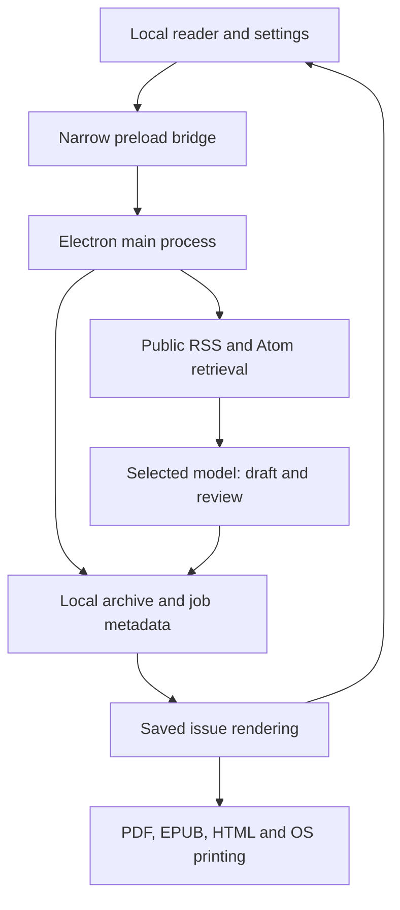

# Architecture

[Project overview](../README.md) · [Privacy](privacy.md) · [Printing](printing.md)

This document describes the desktop source preview, `0.1.0-alpha.1`. The implementation uses Electron with a local ESM reader and small Node.js modules. A shared issue model connects generation, reading, export and printing. Hosted services, mobile clients and device synchronization are not implemented.

## Process and data boundaries

The renderer has no Node integration. Context isolation and sandboxing are enabled. It calls the fixed `window.press` methods exposed by [preload](../src/preload.cjs); [main](../src/main.cjs) checks the sender and owns files, credentials, network access, export dialogs and print operations. Remote browser-window requests and unexpected navigation are blocked. Generated/feed text is untrusted data and is escaped for rendering.

The main process takes a single-instance lock and serializes mutating operations. Generating a manual issue, a scheduled tick, settings changes and printing cannot independently race to create the same daily slot within the application.

## Modules

| Module | Responsibility |
| --- | --- |
| [settings](../src/core/settings.mjs) | Strict nested settings whitelist, types, bounds and defaults; API keys excluded |
| [store](../src/core/store.mjs) | Atomic local JSON writes, date-only issue paths, first-write issue content, separate publication and print metadata |
| [schedule](../src/core/schedule.mjs) | IANA civil dates, gap/fold resolution, 20-minute preparation and persisted change guards |
| [feeds](../src/core/feeds.mjs) | Bounded public HTTPS RSS/Atom retrieval, DNS/address and redirect checks, date filtering and canonicalization |
| [providers](../src/core/providers.mjs) | Official cloud API adapters and a restricted loopback local endpoint |
| [generator](../src/core/generator.mjs) | Evidence-bound prompts, structural/citation checks, optional model review and final issue assembly |
| [entertainment](../src/core/entertainment.mjs) | Date-seeded Sudoku with solution validation and a small original local puzzle/joke bank |
| [vault](../src/core/vault.mjs) | OS-backed encrypted credential blobs, with session-only fallback when protection is unavailable |
| [print ledger](../src/core/print-ledger.mjs) | Pure submission-state transitions and automatic duplicate barriers |
| [newspaper renderer](../src/shared/newspaper.mjs) | Escaped self-contained HTML/CSS for reader, HTML export and print layout |
| [EPUB exporter](../src/core/epub.mjs) | A simpler reflowable EPUB from the same saved issue |
| [professional catalog](../src/shared/domains.mjs) | Localized field/specialism/topic trees, reading perspectives and depth labels |

## Evidence pipeline

1. The collector reads enabled, user-supplied public HTTPS feeds. There is no general web discovery, browser-login reuse, full-page article fetcher or paywall bypass in this version.
2. Each feed has a freshness window, defaulting to 48 hours and bounded to 1–168 hours. The collector rejects entries without usable dates, future/stale entries, unsafe links and empty summaries. It records source publication and retrieval times against a fixed generation cutoff.
3. Canonical URLs and normalized titles remove simple duplicates. Source URLs from the most recent 90 saved issues are supplied as history. This is not a global event graph or proof that different publishers are independent.
4. The selected model receives dated titles/excerpts, professional preferences, desired depth and a bilingual paragraph budget. Source text and free descriptions are marked as untrusted data. The model has no tools, calendar access or independent browsing capability through this adapter.
5. Deterministic checks validate bounded JSON/plain-text fields, permitted source IDs, exact supporting excerpt matches and simple repeated draft content. Malformed or ungrounded candidates are excluded. These tests do not establish semantic truth or source reliability.
6. When enabled, an additional request to the same chosen provider/model reviews consistency with the supplied evidence. Unsupported/contradicted articles are excluded; unresolved analysis is flagged. A failed requested review stops publication. Model agreement is not independent factual verification.
7. The local leisure data and matching manually entered diary events are attached after model calls. If no acceptable articles remain, no official issue is saved.

Every depth uses the same checks. Greater depth changes the requested explanation and scrutiny within the available evidence. It never grants full-text access or permission to manufacture details.

## The immutable issue

An official issue has an ID equal to its `YYYY-MM-DD` publication date. Content includes its creation/cutoff timestamps, timezone, saved language pair, articles, source excerpts, review notes, leisure and a diary snapshot.

`saveIssue` writes a complete temporary file, flushes it, then publishes it with a no-overwrite hard link. Concurrent first writes cannot replace an existing date. Re-saving identical content is idempotent; different content raises `ISSUE_EXISTS`. A filesystem without the required hard-link support fails safely rather than falling back to an overwriting rename.

Content remains stored as `prepared`; publication status and `publishedAt` live in `archive/meta.json`. `getIssue` overlays that state for the reader. This keeps a publish transition from rewriting generated text. The offline sample is separate and cannot be persisted in an official date slot.

Settings and metadata use temporary-file/rename writes. `updateMeta` serializes read-modify-write work; stale metadata writes cannot erase published state or rewind submitted/uncertain print jobs. This is a single-computer archive, not a multi-writer synchronized database. A caller must not run another store method inside an `updateMeta` callback.

## Calendar scheduling and settings changes

The scheduler computes civil dates using the saved IANA timezone, rather than adding fixed 24-hour intervals. `resolveLocalTime` chooses the first occurrence of a repeated time and the first valid instant after a missing time. The next-day preparation window handles deliveries shortly after midnight.

Only today's issue or the imminent next day's early preparation is eligible. Missing old dates are not filled on startup. Generation and publication are separate decisions; a stored prepared issue can be published when due without a new model request.

Manual generation uses the same `canCreateIssue` check and date identity as scheduling. Under the main mutation queue, a settings update computes a `createScheduleGuard` from the previous publication settings, new settings, issue history and prior guard. It saves `meta.schedule.changeGuard` **before** the new settings. A crash between those writes can conservatively defer creation, but cannot reset the daily slot. Existing prepared issues remain eligible for publication.

The guard handles timezone changes; first-write issue IDs permanently handle attempts to reuse a civil date. This is a daily-edition rule, not a rolling 24-hour API quota or a global account limit.

## Rendering and outputs

The issue's saved languages and text are authoritative. The ratio control allocates an approximate paragraph budget during generation; later reader changes only rearrange already stored content. Font, palette and layout changes are local operations, not model calls. A new language request applies to a future issue.

The HTML renderer uses bundled fonts in the desktop view. Print CSS forces white paper and dark ink, with explicit breaks and source notes. PDF is rendered by a hidden, restricted Electron window. EPUB uses the same article/source data in a simpler reflowable package; it does not promise newspaper-identical pagination or every PDF-only diversion. Exports do not implicitly upload or send files to a device.

The main process discovers OS printers, validates the explicit selection, runs a PDF page-count preflight for automatic printing and requires a prior test for the printer/paper/duplex combination. Print helpers produce a `submitting` record that is saved before invoking the OS. Success becomes `submitted`; missing confirmation becomes `uncertain`. Startup recovers interrupted submissions as uncertain. No automatic repeat crosses that barrier. See [Printing](printing.md).

## Security and privacy limits

Cloud adapters allow their official HTTPS endpoints; the optional local adapter accepts only a loopback HTTP(S) OpenAI-compatible service. API credentials are sent in headers to the selected endpoint and are not forwarded to feed redirects. The transport validates public network destinations and uses bounded responses/timeouts. It does not expose an unrestricted network client to the renderer.

Local files are not a fully encrypted database. The credential vault separately uses Electron's suitable secure storage, refusing Linux `basic_text` persistence. Free descriptions and source excerpts are sent to cloud inference when that provider is selected. The manual diary is attached locally. The precise boundaries are documented in [Privacy](privacy.md).

These are implementation controls, not a security-audit certification or a guarantee of model accuracy. The alpha still needs signed release work, wider OS/hardware validation and continued dependency/security review.

## Extending the project

Keep provider selection separate from source retrieval, and keep the issue format separate from device delivery. Future discovery services should return attributable evidence to the same review pipeline; future device adapters should consume saved exports instead of causing another paid generation.

Mobile platforms require deliberate packaging, lifecycle, credentials and background-work designs. HarmonyOS requires its own platform assessment. Neither a responsive reader nor shared JavaScript means standalone mobile management or universal e-reader installation is implemented. Hosted unattended operation would require an explicit service, server-side state and a separate privacy/billing design. These directions remain on the [roadmap](../ROADMAP.md).
